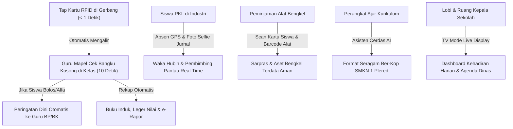

# 📄 PROPOSAL PENGAJUAN IMPLEMENTASI PLATFORM ABSENTA
## Solusi Terpadu Ekosistem Sekolah Modern, Peningkatan Kedisiplinan Siswa, dan Otomasi Administrasi Guru di SMKN 1 Plered

---

**Nomor Dokumen:** 003/PROP-ABSENTA/SMKN1PLD/2026  
**Hal:** Usulan Penerapan Program Kartu Pelajar Pintar & Sistem Manajemen Sekolah Terpadu (Platform Absenta)  
**Pengusul:** Tim Pengembang & Inovasi Internal SMKN 1 Plered  
**Ditujukan Kepada:**  
Yth. **Kepala SMKN 1 Plered**  
cc. **Wakil Kepala Sekolah (Kurikulum, Kesiswaan, Hubinmas, Sarpras), Kepala Tata Usaha, Ketua Komite Sekolah, dan Koordinator BP/BK**  

---

## LEMBAR PENGESAHAN & PERSETUJUAN

Proposal ini disusun berdasarkan kajian mendalam terhadap rutinitas operasional harian, beban administrasi guru, serta kebutuhan pengawasan presensi dan perlindungan siswa di lingkungan SMKN 1 Plered:

| Unsur / Bidang | Jabatan | Paraf & Tanggal |
| :--- | :--- | :--- |
| **Pengusul** | Tim Inovasi Internal Absenta | ................................... |
| **Waka Kurikulum** | Urusan KBM, Perangkat Ajar & Pembagian Jam | ................................... |
| **Waka Kesiswaan** | Urusan Disiplin, Tata Tertib & Ketidakhadiran | ................................... |
| **Waka Hubinmas** | Urusan PKL, Hubungan Industri & BKK | ................................... |
| **Waka Sarpras** | Urusan Alat Praktik Bengkel/Lab & Fasilitas | ................................... |
| **Koordinator BP/BK** | Urusan Pendampingan & Pembinaan Siswa | ................................... |
| **Ketua Koperasi** | Urusan Toko Sekolah & Ekosistem Siswa | ................................... |
| **Ketua Komite** | Perwakilan Orang Tua Siswa | ................................... |
| **Menyetujui:** | **Kepala SMKN 1 Plered** | ................................... |

---

## DAFTAR ISI
1. [Ringkasan Eksekutif (Bagi Pimpinan Sekolah)](#1-ringkasan-eksekutif-bagi-pimpinan-sekolah)
2. [Latar Belakang: Masalah Nyata Sehari-hari di Lapangan SMKN 1 Plered](#2-latar-belakang-masalah-nyata-sehari-hari-di-lapangan-smkn-1-plered)
3. [Solusi Platform Absenta: Sistem Pintar yang Saling Terhubung Otomatis](#3-solusi-platform-absenta-sistem-pintar-yang-saling-terhubung-otomatis)
4. [Katalog Modul Unggulan Sistem Absenta](#4-katalog-modul-unggulan-sistem-absenta)
5. [Model Skema Pengadaan: Program Kartu Pelajar Pintar Terpadu](#5-model-skema-pengadaan-program-kartu-pelajar-pintar-terpadu)
6. [Analisis Komparasi Infrastruktur: On-Premise vs Full Cloud](#6-analisis-komparasi-infrastruktur-on-premise-vs-full-cloud)
7. [Rencana Uji Coba (Pilot Project) 30 Hari Tanpa Risiko](#7-rencana-uji-coba-pilot-project-30-hari-tanpa-risiko)
8. [Penutup & Rekomendasi](#8-penutup--rekomendasi)

---

## 1. RINGKASAN EKSEKUTIF (BAGI PIMPINAN SEKOLAH)

Bapak Kepala Sekolah dan jajaran pimpinan yang kami hormati,

Sebagai bagian dari warga internal SMKN 1 Plered yang bertugas di lapangan setiap hari, kami mengamati bahwa tantangan utama sekolah saat ini berkisar pada tiga hal mendasar:
1. **Beban Administrasi Guru yang Berlebihan:** Guru menghabiskan hingga 15–20 menit di awal setiap jam pelajaran hanya untuk memanggil absen 36 siswa secara manual, serta kelelahan mengetik dokumen kurikulum, modul ajar, dan administrasi nilai hingga larut malam.
2. **Celah Disiplin Siswa ("Hadir Pagi, Hilang di Jam Siang"):** Banyak siswa hadir di gerbang pagi hari demi menghindari hukuman piket, tetapi membolos saat jam pergantian pelajaran atau jam praktik di bengkel tanpa terpantau secara *real-time*.
3. **Kekhawatiran Orang Tua Murid:** Orang tua di rumah tidak memiliki kepastian informasi apakah anak mereka benar-benar berada di dalam kelas atau sedang berkeliaran di luar sekolah.

**Platform Absenta** hadir sebagai inovasi mandiri warga sekolah untuk menyatukan seluruh tata kelola sekolah dalam satu genggaman. Sistem ini mengintegrasikan:
- **Presensi Gerbang Cepat (< 1 detik/siswa)** dengan Kartu Pelajar Pintar RFID.
- **Otomasi Presensi Jam KBM (*Smart Auto-Propagation*):** Guru cukup melirik bangku kosong selama 10 detik tanpa perlu memanggil absen satu per satu.
- **Asisten AI Kurikulum & Modul Ajar:** Membantu guru merapikan modul ajar dan perangkat Kurikulum Merdeka secara instan ber-Kop resmi SMKN 1 Plered.
- **Monitoring PKL/Hubin Terpadu:** Pengawasan presensi berbasis GPS dan jurnal kegiatan siswa di dunia industri (DUDI).
- **Pengawasan Sarpras & Peminjaman Alat Bengkel:** Menghilangkan risiko alat praktik kejuruan hilang atau rusak tanpa jejak.

### Skema Pembiayaan yang Aman & Tanpa Beban APBS/BOS:
Untuk menghindari birokrasi pengadaan software yang rumit dan tidak membebani anggaran dana BOS sekolah, program ini dirancang melalui **Program Kartu Pelajar Pintar & Perlindungan Siswa Terpadu** senilai **Rp 80.000 / tahun per siswa** (hanya setara **Rp 6.600 / bulan** atau **Rp 400 / hari sekolah**).

Skema ini memberikan manfaat berlipat:
- **Siswa & Orang Tua:** Menerima fisik kartu RFID 2 sisi berkualitas industri doff, gantungan lanyard eksklusif identitas SMKN 1 Plered, casing pelindung, serta notifikasi perlindungan presensi harian.
- **Sekolah:** Menerima bagi hasil tunai **Rp 10.000 / siswa (Rp 25.000.000 untuk 2.500 siswa)** yang masuk langsung ke Kas Sekolah / Koperasi / Komite.
- **Infrastruktur & Cloud:** Menjamin server berkecepatan tinggi, sistem backup harian, dan pemeliharaan teknis tanpa biaya tambahan dari sekolah.

---

## 2. LATAR BELAKANG: MASALAH NYATA SEHARI-HARI DI LAPANGAN SMKN 1 PLERED

Kebutuhan akan platform ini bukan sekadar mengikuti tren digitalisasi, melainkan solusi nyata atas permasalahan konkret yang terjadi setiap hari di SMKN 1 Plered:

### 2.1. Presensi Gerbang Pagi: Penumpukan Siswa & Kekhawatiran Orang Tua
- **Fakta Lapangan:** Antara pukul 06.30 hingga 07.00 WIB, ribuan siswa tiba hampir bersamaan di gerbang depan. Metode manual atau scanner lambat memicu antrean panjang hingga ke jalan raya. Orang tua di rumah cemas karena tidak ada kabar apakah anaknya telah selamat tiba di sekolah.
- **Solusi Absenta:** Siswa melakukan tap kartu RFID dalam hitungan 0,5 detik. Jam kedatangan tercatat otomatis, gerbang tetap tertib, dan data langsung terdistribusi ke seluruh wali kelas dan pimpinan.

### 2.2. Presensi Kelas & Bengkel: Fenomena Siswa Menghilang di Jam Siang
- **Fakta Lapangan:** Siswa kerap hadir saat apel pagi di gerbang, namun saat siang hari beralih ke kantin, nongkrong di sudut sekolah, atau membolos keluar. Guru mata pelajaran terpaksa membuang waktu 10–15 menit di awal jam KBM untuk memanggil absen 36 siswa satu per satu.
- **Solusi Absenta (*KBM Auto-Propagation*):** Sistem secara otomatis meneruskan status kehadiran gerbang ke daftar hadir kelas jam pelajaran tersebut. Guru tidak perlu memanggil semua nama; cukup melirik bangku yang kosong selama 10 detik. Jika ada siswa yang pagi ada di gerbang namun siang tidak ada di kelas, sistem langsung menandai secara otomatis.

### 2.3. Beban Berkas Kurikulum Merdeka Guru
- **Fakta Lapangan:** Guru kelelahan menyusun berkas administrasi perangkat ajar (CP, ATP, Modul Ajar, Prota, Promes, asesmen P5). Waktu guru habis di depan laptop hingga larut malam alih-alih fokus menyiapkan materi praktik kejuruan.
- **Solusi Absenta:** Tersedia generator asisten ajar berbasis AI yang disesuaikan dengan kebutuhan kejuruan SMKN 1 Plered. Cukup pilih konsentrasi keahlian dan materi pokok, draf instrumen tersusun rapi berformat resmi sekolah.

### 2.4. Pemantauan Siswa PKL di Dunia Usaha & Industri (Hubinmas)
- **Fakta Lapangan:** Ratusan siswa tingkat akhir terpencar di berbagai bengkel, pabrik, dan kantor rekanan di Purwakarta, Karawang, hingga Bekasi. Buku jurnal fisik rawan hilang, rusak, atau baru diisi rekayasa menjelang penarikan PKL.
- **Solusi Absenta:** Siswa melakukan absensi masuk dan pulang langsung dari tempat magang menggunakan verifikasi koordinat GPS dan foto selfie kerja. Guru pembimbing dan Waka Hubinmas dapat memantau kedisiplinan siswa di industri secara *real-time*.

### 2.5. Keamanan Aset Alat Praktik di Bengkel (Sarpras)
- **Fakta Lapangan:** Di sekolah kejuruan, alat ukur presisi (*micrometer, multimeter, scanner ECU*) bernilai jutaan rupiah rawan terselip, rusak tanpa penanggung jawab, atau hilang karena catatan peminjaman di buku bon sering hilang lembarannya.
- **Solusi Absenta:** Setiap peminjaman alat praktik dicatat melalui scan kartu siswa atau barcode alat. Sistem mencatat siapa peminjam, jam pinjam, kondisi alat, serta instruktur penanggung jawab bengkel.

### 2.6. Penanganan Siswa oleh Guru BP/BK Sering Terlambat
- **Fakta Lapangan:** Guru BP/BK sering baru mengetahui seorang siswa sering membolos setelah ketidakhadiran mencapai belasan kali atau saat orang tua dipanggil dalam kondisi krisis.
- **Solusi Absenta (*Early Warning System*):** Sistem otomatis mendeteksi pola ketidakhadiran. Jika siswa tidak masuk 3 kali berturut-turut atau akumulasi alfa mencapai batas tertentu, sistem langsung memicu notifikasi peringatan dini ke akun Guru BK untuk pendampingan preventif.

---

## 3. SOLUSI PLATFORM ABSENTA: SISTEM PINTAR YANG SALING TERHUBUNG OTOMATIS

Seluruh modul dalam Platform Absenta dirancang menggunakan arsitektur modern yang saling mengalirkan data tanpa perlu input berulang:

---

## 4. KATALOG MODUL UNGGULAN SISTEM ABSENTA

Platform Absenta menyediakan modul operasional terlengkap yang dirancang khusus untuk kultur sekolah kejuruan (SMK):

| No | Modul Sistem | Fitur Unggulan Utama | Dampak bagi SMKN 1 Plered |
| :---: | :--- | :--- | :--- |
| **1** | **Smart Gate Attendance** | Presensi RFID kilat (< 0,5 dtk), Anti-Passback, Layar Sapa Suara, Multi-Gate Scanner. | Gerbang tertib, bebas antrean, data masuk sekolah akurat dan terlindungi. |
| **2** | **KBM Auto-Propagation** | Kehadiran gerbang langsung mengalir ke 55 rombel. Guru hanya cek bangku kosong (10 detik). | Menghemat waktu KBM guru 15 menit setiap jam; mendeteksi siswa yang kabur di jam siang. |
| **3** | **Modul Kurikulum & AI Lesson Plan** | Perumusan CP, ATP, Modul Ajar, Prota, Promes Kurikulum Merdeka ber-Kop surat resmi sekolah. | Mengurangi stres administrasi guru; perangkat ajar rapi dan seragam sesuai standar industri. |
| **4** | **Modul Akademik & Penilaian** | Manajemen rombel, jadwal bentrok ruang bengkel, leger nilai, konversi bobot otomatis. | Nilai terpusat, bebas kesalahan rumus Excel manual, cetak rapor cepat. |
| **5** | **Modul Kesiswaan & Poin Karakter** | Pencatatan reward prestasi & punishment pelanggaran (tata tertib), kartu kendali siswa. | Penegakan tata tertib transparan, adil, dan tercatat dalam riwayat portofolio siswa. |
| **6** | **Modul BP/BK (Bimbingan Konseling)** | *Early Warning System* (EWS) deteksi siswa bermasalah, catatan konseling rahasia, surat panggilan ortu. | Penanganan siswa preventif sebelum menjadi masalah fatal; kerahasiaan data konseling terjamin. |
| **7** | **Modul Hubinmas & PKL Mandiri** | Presensi mobile radius GPS, selfie kerja harian, jurnal kegiatan DUDI, penilaian pembimbing industri. | Efisiensi monitoring ratusan siswa di industri luar; tidak perlu cetak buku jurnal ratusan ribu rupiah. |
| **8** | **Modul Sarpras & Bengkel Kejuruan** | Inventarisasi alat per bengkel/lab, barcode scanner peminjaman alat, log riwayat kerusakan/hilang. | Menjaga aset alat praktik sekolah bernilai puluhan juta rupiah dari kehilangan atau kerusakan. |
| **9** | **Modul Koperasi & Transaksi Kantin** | Sistem kasir (POS), pencatatan seragam/atribut PPDB, simpan pinjam anggota guru, rekap SHU. | Administrasi koperasi sekolah transparan, pembagian seragam tertib, bebas salah hitung. |
| **10** | **TV Mode Dashboard Lobi** | Tampilan layar besar real-time untuk lobi utama dan ruang pimpinan (status hadir, statistik, agenda). | Sekolah tampil modern dan meyakinkan di mata tamu dinas, pengawas, dan industri mitra. |

---

## 5. MODEL SKEMA PENGADAAN: PROGRAM KARTU PELAJAR PINTAR TERPADU

Agar penerapan sistem ini tidak menemui hambatan birokrasi, tidak memerlukan proses tender/e-Katalog perangkat lunak yang rumit, dan tidak melanggar ketentuan regulasi pembiayaan sekolah, kami mengusulkan skema pengadaan melalui:

### **"Program Kartu Pelajar Pintar & Layanan Perlindungan Siswa SMKN 1 Plered"**

* **Biaya per Siswa:** **Rp 80.000 / tahun**  
  *(Dapat dibebankan pada saat masa pendaftaran ulang/PPDB atau awal tahun ajaran baru).*
* **Ekivalensi Biaya:** Hanya setara **Rp 6.666 / bulan** atau **Rp 400 / hari sekolah**.

### Rincian Manfaat Paket yang Diterima Setiap Siswa:
1. **Fisik Kartu Pelajar RFID Eksklusif:** Kartu PVC RFID chip 13.56 MHz (Mifare) kualitas cetak 2 sisi laminasi doff berstandar industri.
2. **Aksesoris Identitas Resmi:** Tali Lanyard berlogo resmi SMKN 1 Plered + Wadah Casing Akrilik pelindung geser (*slide case*) transparan.
3. **Akun Digital Siswa & Portofolio:** Akses akun portal kehadiran, jadwal KBM, riwayat presensi, dan fitur PKL.
4. **Layanan Notifikasi Perlindungan Kehadiran:** Sistem pemberitahuan status kehadiran siswa kepada orang tua.

### Proyeksi Arus Kas & Bagi Hasil Finansial Sekolah (Tahun Pertama - 2.500 Siswa):

| Komponen Rincian Anggaran | Perhitungan Unit | Total Rupiah |
| :--- | :--- | :--- |
| **Total Penerimaan Kartu Siswa** | $2.500 \text{ Siswa} \times \text{Rp } 80.000$ | **Rp 200.000.000** |
| **1. Pengadaan Fisik Kartu (Vendor)** | $2.500 \text{ Siswa} \times \text{Rp } 35.000$ *(Kartu + Cetak Doff + Lanyard + Case)* | (Rp 87.500.000) |
| **2. PENDAPATAN TUNAI KAS SEKOLAH** | $2.500 \text{ Siswa} \times \text{Rp } 10.000$ *(Kas Sekolah / Komite / Koperasi)* | **Rp 25.000.000** |
| **3. Biaya Sewa Cloud Server (1 Tahun)** | Paket Enterprise Cloud VPS Biznet (Spek Tangguh 12 vCPU / 24 GB RAM) | (Rp 27.588.000) |
| **4. Alokasi Perangkat Pos Gerbang** | 2x Unit Tablet POS Gerbang + 4x Reader RFID + Aksesoris Hub | (Rp 9.500.000) |
| **5. Dana Cadangan Operasional & Perawatan** | Kuota broadcast, kartu buffer pengganti, dan perawatan sistem | (Rp 10.412.000) |
| **SISA SURPLUS OPERASIONAL TIM PENGEMBANG** | Insentif tim teknis, operasional, & pendampingan penuh 1 tahun | **Rp 40.000.000** |

> **Catatan Finansial Penting bagi Pimpinan Sekolah:**
> Sekolah **tidak mengeluarkan dana kas APBS/BOS sepeser pun (Rp 0)**, namun sekolah langsung menerima suntikan kas segar sebesar **Rp 25.000.000 tunai** serta seluruh fasilitas digitalisasi sekolah langsung beroperasi secara profesional dan modern.

---

## 6. ANALISIS KOMPARASI INFRASTRUKTUR: ON-PREMISE VS FULL CLOUD

Kami menyajikan kajian perbandingan teknis dan finansial yang objektif antara membangun server fisik sendiri di sekolah (*On-Premise*) versus memanfaatkan *Full Cloud Enterprise*:

### 6.1. Matriks Perbandingan Teknis & Operasional Lapangan

| Parameter Evaluasi | Skenario On-Premise (Server Fisik di Sekolah) | Skenario Full Cloud (Data Center Biznet GIO) |
| :--- | :--- | :--- |
| **Kebutuhan Modal Awal (Capex)** | **SANGAT TINGGI (Rp 122 Juta)** Wajib beli server Dell PowerEdge T150, UPS besar, tarikan kabel LAN ke 55 ruang kelas, dan reader di tiap kelas. | **SANGAT HEMAT (Rp 9,5 Juta)** Nol rupiah belanja server. Cukup pengadaan reader gerbang dan tablet pos meja piket. |
| **Akses di Luar Sekolah (PKL & Ortu)** | **TERBATAS & RENTAN PUTUS** Memerlukan setting IP Publik statis, port forwarding, atau VPN tunnel yang sangat rentan down jika internet sekolah mati. | **AKTIF PENUH 24 JAM** Siswa PKL di pabrik/industri dan orang tua dapat membuka portal absensi dari smartphone di mana saja tanpa hambatan. |
| **Ketahanan Listrik & Cuaca Ekstrem** | **RENTAN GANGGUAN** Jika PLN padam berjam-jam, UPS habis dan server mati mendadak. Rentan rusak akibat sambaran petir di musim hujan. | **STANDAR TINGGI (Uptime 99.9%)** Ditempatkan di Data Center Tier-3 dengan genset otomatis ganda, pendingin presisi, dan proteksi kebakaran industri. |
| **Instalasi di 55 Ruang Kelas** | **SANGAT RUMIT & RAWAN RUSAK** Kabel jaringan ke 55 rombel rawan putus, digigit tikus, dan reader fisik di kelas rawan dicabut atau dirusak siswa. | **BEBAS KABEL & BEBAS BIAYA** Menggunakan fitur pintar *KBM Auto-Propagation*. Guru cukup akses dari HP/laptop pribadi; nol rupiah kabel dan reader kelas. |
| **Beban Staf Teknisi Sekolah** | **BERAT** Teknisi sekolah harus rutin membersihkan debu kipas, ganti baterai UPS, perbaikan kabel, dan backup manual. | **RINGAN & FOKUS PENDAMPINGAN** Pemeliharaan hardware dan keamanan server ditangani tim data center. Teknisi sekolah fokus membantu guru. |

### 6.2. Ringkasan Total Cost of Ownership (TCO) 3, 5, dan 10 Tahun

| Horizon Waktu | Skenario On-Premise (Server Lokal) | Skenario Full Cloud (Biznet Enterprise) | Analisis & Rekomendasi Lapangan |
| :---: | :---: | :---: | :--- |
| **3 Tahun** *(1 Siklus Angkatan)* | **Rp 147.500.000** | **Rp 93.764.000** | 🏆 **Full Cloud Lebih Hemat Rp 53.736.000!** Menghindarkan sekolah dari kewajiban mengeluarkan modal Rp 122 Juta di awal. |
| **5 Tahun** *(Batas Garansi Pabrik)* | **Rp 164.500.000** | **Rp 149.940.000** | 🏆 **Full Cloud Tetap Lebih Hemat Rp 14.560.000!** Di tahun ke-5 server lokal mulai aus dan baterai UPS wajib diganti. |
| **10 Tahun** *(Siklus Peremajaan)* | **Rp 277.000.000** | **Rp 290.380.000** | ⚖️ Biaya jangka 10 tahun relatif berimbang, **TETAPI Cloud bebas dari risiko kerusakan fatal dan kerumitan teknis di sekolah.** |

> **Rekomendasi Mutlak:**  
> Untuk SMKN 1 Plered, opsi **FULL CLOUD** adalah opsi terbaik, paling aman secara anggaran, dan langsung memberikan keuntungan finansial sejak hari pertama tanpa menanggung risiko kerusakan perangkat keras di sekolah.

---

## 7. RENCANA UJI COBA (PILOT PROJECT) 30 HARI TANPA RISIKO

Untuk memastikan seluruh pihak dapat beradaptasi secara nyaman dan membuktikan efektivitas sistem sebelum peluncuran massal, kami menawarkan **Uji Coba Terbatas (Pilot Project) selama 30 Hari Kerja** dengan ketentuan:

1. **Sampel Kelas Uji Coba:**
   - **1 Rombel Kelas X:** Menguji alur tap gerbang dan adaptasi kartu pelajar baru.
   - **1 Rombel Kelas XI (Bengkel Kejuruan):** Menguji presensi KBM jam pelajaran dan pencatatan peminjaman alat praktik bengkel.
   - **1 Rombel Kelas XII (Jurusan PKL):** Menguji presensi radius GPS mandiri dan pengisian jurnal kegiatan di industri mitra.
2. **Kesiapan Pendampingan:**
   Tim pengembang akan mendampingi secara langsung setiap pagi di gerbang dan di ruang guru untuk memastikan para bapak/ibu guru dapat mengoperasikan sistem dengan lancar dan mudah.
3. **Laporan Evaluasi:**
   Di akhir masa uji coba, tim akan memaparkan laporan statistik penghematan waktu KBM dan testimoni kepuasan guru serta pembimbing industri kepada Bapak Kepala Sekolah.

---

## 8. PENUTUP & REKOMENDASI

Implementasi Platform Absenta dan Program Kartu Pelajar Pintar ini merupakan lompatan strategis untuk memposisikan **SMKN 1 Plered sebagai SMK Pusat Keunggulan yang modern, transparan, dan tertib secara digital**. 

Program ini menyelesaikan tiga masalah sekaligus dalam satu langkah:
1. Menertibkan kedisiplinan dan keselamatan 2.500 siswa.
2. Meringankan beban kerja dan administrasi ratusan bapak/ibu guru.
3. Menghasilkan pendapatan kas sekolah mandiri tanpa membebani kas BOS daerah.

Kami memohon restu dan perkenan dari Bapak Kepala SMKN 1 Plered beserta jajaran pimpinan untuk memberikan izin pelaksanaan **Uji Coba Percontohan (Pilot Project) 30 Hari**.

Atas perhatian, bimbingan, dan dukungan yang senantiasa Bapak berikan, kami haturkan terima kasih yang sebesar-besarnya.

---

*Plered, 12 Oktober 2026*  
**Hormat kami,**  

**Tim Pengembang & Inovasi Internal Platform Absenta**  
*SMKN 1 Plered*
