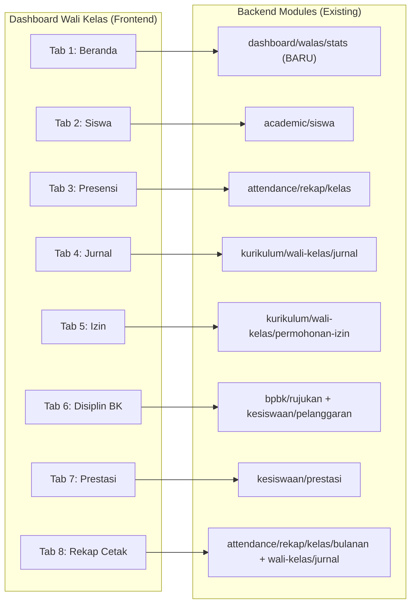
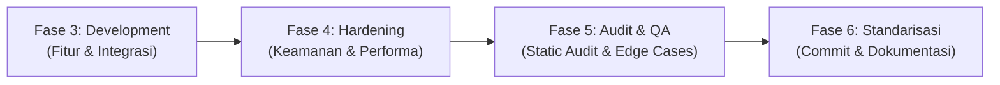

# 📋 Spesifikasi Teknis (Feature Spec): Dashboard Wali Kelas SMK
**Fase 2 SDLC — Hasil Rekonsiliasi Nyata Codebase (Bukan Greenfield, tapi Orchestra)**

> [!IMPORTANT] **Prinsip: Rekonsiliasi, Bukan Bangun dari Nol**
> Dokumen ini disusun SETELAH audit nyata pada codebase backend dan frontend. Seluruh endpoint, service, dan API client yang sudah ada **dipakai ulang (reuse)**. Hanya **gap yang sesungguhnya tidak ada** yang akan dibangun baru. Tidak ada endpoint duplikasi atau service redundan.

---

## 🔬 I. Hasil Audit Codebase — Inventori Modul Backend yang Relevan

### A. Modul yang SUDAH ADA & Langsung Bisa Dikonsumsi

#### 1. `kurikulum/wali-kelas` — Core Modul Walas ✅ Lengkap
File: `absenta_backend/src/modules/kurikulum/wali-kelas/`

| Endpoint (prefix: `/kurikulum/wali-kelas`) | Capability | Kegunaan di Dashboard Walas |
|---|---|---|
| `GET /struktur` | `academic.homeroom.manage` | Resolusi kelas binaan guru + data wali kelas historis |
| `GET /by-siswa/:siswaId` | `academic.homeroom.manage` | Riwayat wali kelas siswa |
| `GET /jurnal` | `determineDataScope` | Tab Jurnal: Ambil daftar catatan pembinaan |
| `POST /jurnal` | `determineDataScope` | Tab Jurnal: Input catatan bimbingan |
| `DELETE /jurnal/:id` | `determineDataScope` | Tab Jurnal: Hapus jurnal |
| `GET /permohonan-izin` | `determineDataScope` | Tab Izin: Inbox permohonan sakit/izin ortu (filter `?kelas_id&status=PENDING`) |
| `POST /permohonan-izin` | `determineDataScope` | Tab Izin: Buat permohonan izin manual |
| `PATCH /permohonan-izin/:id/status` | `determineDataScope` | Tab Izin: Approval/Tolak surat sakit dokter |
| `GET /ews` | `determineDataScope` | Tab Beranda & Presensi: Early Warning System siswa at-risk |
| `GET /sk-arsip` | `determineDataScope` | Tab Rekap: Arsip SK Wali Kelas historis |

> [!NOTE] **Frontend API client sudah tersedia** di `src/api/kurikulum/waliKelas.api.ts` — `getJurnalWaliKelasList`, `createJurnalWaliKelas`, `getPermohonanIzinList`, `updatePermohonanIzinStatus`, `getEwsPerKelasList`.

---

#### 2. `academic/siswa` — Data Roster Siswa Rombel ✅ Ada
File: `absenta_backend/src/modules/academic/siswa/routes/siswa.routes.ts`

| Endpoint (prefix: `/academic/siswa`) | Capability | Kegunaan di Dashboard Walas |
|---|---|---|
| `GET /` | `academic.students.view.list` | Tab Siswa: Daftar siswa rombel (filter `?kelas_id&status=AKTIF`) |
| `GET /:id` | `academic.students.view.detail` | Modal detail siswa: profil, foto, kontak ortu, NISN |
| `GET /:id/history` | `academic.students.view.history` | Tab Siswa: Riwayat mutasi & timeline akademik siswa |
| `GET /:id/timeline` | `academic.students.view.history` | Riwayat kehadiran & pembinaan siswa lintas semester |

> [!NOTE] **Frontend API client sudah tersedia** di `src/api/kurikulum/waliKelas.api.ts` — `getSiswaWalasList` (memanggil `GET /academic/siswa?kelas_id=xxx`).

---

#### 3. `academic/kelas` — Info Rombel & Struktur Kelas ✅ Ada
File: `absenta_backend/src/modules/academic/kelas/routes/kelas.routes.ts`

| Endpoint (prefix: `/academic/kelas`) | Capability | Kegunaan di Dashboard Walas |
|---|---|---|
| `GET /:id` | `academic.classes.view.list` | Tab Beranda: Info kelas (nama, tingkat, jurusan, kapasitas, ruang) |
| `GET /` | `academic.classes.view.list` | Selector multi-kelas jika guru membina >1 kelas |

---

#### 4. `attendance/rekap` — Presensi & Matriks Kehadiran ✅ Ada
File: `absenta_backend/src/modules/attendance/rekap/routes/rekap.routes.ts`

| Endpoint (prefix: `/attendance/rekap`) | Capability | Kegunaan di Dashboard Walas |
|---|---|---|
| `GET /kelas/:id/harian` | `attendance.recap.view.daily` | Tab Beranda: Presensi hari ini rombel (Hadir, Sakit, Izin, Alfa) |
| `GET /kelas/:id/bulanan` | `attendance.recap.view.monthly` | Tab Presensi: Matriks kalender kehadiran bulanan per siswa |
| `GET /siswa/:id/bulanan` | `attendance.recap.view.monthly` | Tab Presensi: Matriks per siswa untuk drill-down detail |
| `GET /kelas/:id/lineage` | `attendance.recap.view.monthly` | Rekap linimasa kohort rombel (naik kelas ke tingkat berikutnya) |
| `GET /statistik/harian` | `attendance.reports.view` | Tab Beranda: KPI kehadiran real-time hari ini |

> [!NOTE] **Frontend API client sudah tersedia** di `src/api/attendance/rekap.api.ts` — `getRekapKelasBulanan`, `getRekapHarianGuru`.

---

#### 5. `attendance/sesi-absensi` — KBM Aktif Rombel Hari Ini ✅ Ada
File: `absenta_backend/src/modules/attendance/sesi-absensi/routes/sesi-absensi.routes.ts`

| Endpoint (prefix: `/attendance/sesi-absensi`) | Capability | Kegunaan di Dashboard Walas |
|---|---|---|
| `GET /` | `attendance.sessions.view.detail` | Tab Beranda: Cek sesi KBM yang sedang berlangsung di kelas rombel hari ini |
| `GET /:id/summary` | `attendance.sessions.view.detail` | Detail sesi aktif (mapel, guru, jam ke-, kehadiran siswa per sesi) |
| `GET /teacher-locator` | `attendance.officers.view` | Badge: Posisi guru yang sedang mengajar di kelas |

---

#### 6. `kesiswaan/pelanggaran` — Rekap Pelanggaran Siswa ✅ Ada
File: `absenta_backend/src/modules/kesiswaan/routes/pelanggaran.routes.ts`

| Endpoint (prefix: `/kesiswaan/pelanggaran`) | Capability | Kegunaan di Dashboard Walas |
|---|---|---|
| `GET /` | `affairs.violations.view.list` | Tab Disiplin: Log pelanggaran siswa rombel (filter `?kelas_id`) |
| `GET /:id` | `affairs.violations.view.detail` | Detail kasus pelanggaran individual |
| `POST /` | `affairs.violations.report` | Tab Disiplin: Input pelanggaran baru oleh Wali Kelas |
| `GET /analytics` | `affairs.violations.view.list` | Tab Disiplin: Statistik tren pelanggaran |

> [!NOTE] **Frontend API client sudah tersedia** di `src/api/kurikulum/waliKelas.api.ts` — `getPelanggaranList`.

---

#### 7. `kesiswaan/prestasi` — Rekap Prestasi Siswa ✅ Ada
File: `absenta_backend/src/modules/kesiswaan/routes/prestasi.routes.ts`

| Endpoint (prefix: `/kesiswaan`) | Capability | Kegunaan di Dashboard Walas |
|---|---|---|
| `GET /prestasi` | `affairs.achievements.view.list` | Tab Prestasi: Daftar capaian siswa rombel (filter `?kelas_id`) |
| `POST /prestasi` | `affairs.achievements.create` | Tab Prestasi: Input prestasi/penghargaan siswa baru |
| `GET /prestasi/leaderboard` | `affairs.achievements.view.list` | Tab Prestasi: Papan peringkat prestasi kelas |

> [!NOTE] **Frontend API client sudah tersedia** di `src/api/kurikulum/waliKelas.api.ts` — `getPrestasiList`.

---

#### 8. `bpbk` — Kasus BK, Konseling & Kolaborasi Guru BK ✅ Lengkap
File: `absenta_backend/src/modules/bpbk/routes/bpbk.routes.ts`

| Endpoint (prefix: `/bpbk`) | Capability | Kegunaan di Dashboard Walas |
|---|---|---|
| `GET /cases` | `bk.cases.view.list` | Tab Disiplin: Daftar kasus BK yang melibatkan siswa rombel |
| `POST /rujukan` | `bk.referrals.create` | Tab Disiplin: Buat rujukan alih tangan kasus ke Guru BK (1 klik) |
| `GET /reports/walikelas` | `bk.cases.view.list` | Tab Disiplin: Ringkasan laporan kasus per kelas untuk wali kelas |
| `GET /pemanggilan` | `bk.cases.view.list` | Tab Disiplin: Daftar surat pemanggilan orang tua |
| `POST /home-visit` | `bk.cases.view.list` | Tab Disiplin: Catat jadwal & hasil kunjungan rumah (home visit) |

> [!NOTE] **Frontend API client sudah tersedia** di `src/api/bpbk.api.ts` — `bpbkApi.getCases`, `bpbkApi.createRujukan`.

---

#### 9. `dashboard` — Kapabilitas `dashboard.view.walikelas` ✅ Ada tapi Belum Ada Service
File: `absenta_backend/src/modules/dashboard/routes/sub/dashboard-role.routes.ts`

> [!CAUTION] **GAP DITEMUKAN:** Endpoint `GET /dashboard/walas/stats` **BELUM ADA** di `dashboard-role.routes.ts`. Saat ini ada: `/kaprog/stats`, `/kepegawaian/stats`, `/toolman/stats`, `/kabeng/stats`, `/bkk/stats` — tapi **tidak ada `/walas/stats`**. Ini adalah **satu-satunya komponen yang harus dibangun baru** di backend.

---

### B. Yang PERLU DIBANGUN Baru (Gap Sesungguhnya)

| Komponen Baru | Scope | Justifikasi |
|---|---|---|
| `DashboardWalasStatsService` | Backend (Dashboard Module) | Aggregator ringan yang memanggil kembali service-service yang sudah ada (rekap, ews, izin pending) — **bukan duplikasi**, tapi **orkestrasi** |
| `GET /dashboard/walas/stats` | Backend Route | Entry point tunggal untuk ringkasan KPI dashboard (kehadiran hari ini, alert EWS, izin pending) |
| `useWalasDashboardData` hook | Frontend Hook | React Query hook yang mengonsumsi endpoint summary baru di atas |

---

## 🏗️ II. Peta Rekonsiliasi: Fitur Dashboard vs Sumber Backend



---

## 🛡️ III. Acceptance Criteria (Gherkin Syntax)

### Fitur 1: Konteks Akademik & Penelusuran Historis Kelas Binaan
```gherkin
Feature: Inspeksi Rombel Masa Lampau via OrganizationalAssignment Historis
  Scenario: Mode Live Operasional (Tahun Berjalan)
    Given Guru memiliki OrganizationalAssignment aktif dengan Position.code = 'WALIKELAS' dan kelas_id terisi
    When Guru membuka Dashboard Wali Kelas pada semester aktif
    Then Badge hijau "LIVE OPERASIONAL" tampil di hero banner
    And Data presensi real-time kelas (GET /attendance/rekap/kelas/:id/harian) di-fetch
    And Formulir input jurnal, approval izin AKTIF (tidak disabled)

  Scenario: Mode Arsip Historis (Masa Lampau)
    Given Guru memilih Tahun Pelajaran selain yang aktif di AcademicFilterToolbar
    When Data di-refetch dengan tahun_pelajaran_id yang baru
    Then Badge amber "HISTORIS ARSIP" tampil
    And Tombol input jurnal & approval izin DISABLED dengan tooltip "Periode akademik telah berakhir"
    And Rekap bulanan historis tetap dapat diakses dan dicetak ulang
```

### Fitur 2: EWS Siswa At-Risk
```gherkin
  Scenario: Siswa alfa >= 3 hari berturut-turut
    Given API GET /kurikulum/wali-kelas/ews?kelas_id=xxx mengembalikan data siswa at-risk
    When Wali Kelas membuka Tab Beranda
    Then Alert strip merah tampil dengan nama siswa dan hitungan hari alfa
    And Tombol "Hubungi Ortu via WhatsApp" mengarah ke wa.me/{nomorHP} yang valid
    And Tombol "Rujuk ke BK" membuka dialog form POST /bpbk/rujukan
```

### Fitur 3: Approval Izin Siswa
```gherkin
  Scenario: Menyetujui surat sakit dokter
    Given Terdapat record PermohonanIzinSiswa dengan status PENDING di database
    When Wali Kelas menekan Setujui dan mengonfirmasi dialog
    Then PATCH /kurikulum/wali-kelas/permohonan-izin/:id/status {status: "DISETUJUI"} dipanggil
    And queryClient.invalidateQueries(['walas-permohonan-izin', kelasId]) dijalankan
    And Badge counter izin pending di Tab Bar berkurang otomatis tanpa reload halaman
```

---

## 🔄 IV. Edge Cases & Mitigasi

| Edge Case | Mitigasi |
|---|---|
| Guru tidak memiliki `kelas_id` di `OrganizationalAssignment` | Tampilkan `<WalasNoClassState />` — panduan hubungi Waka Kurikulum untuk tetapkan penugasan |
| Buka periode historis, coba submit jurnal | Form `disabled` + tooltip + backend guard (cek apakah `tahunPelajaran.is_active === false`) |
| Nomor HP ortu kosong | Tombol WhatsApp `disabled` + tooltip: "Nomor belum terdaftar" |
| Siswa mutasi keluar kelas di tengah semester | Filter menggunakan `SiswaAkademik.status = 'AKTIF'` dengan join rentang tanggal |
| Koneksi gagal saat approval izin | TanStack Query optimistic update + rollback otomatis + toast error informatif |

---

## 📦 V. Inventori Frontend API Clients — Status & Kebutuhan

| API Function | File Sumber | Status | Tab Pengguna |
|---|---|---|---|
| `getEwsPerKelasList` | `waliKelas.api.ts` | ✅ Ada | Tab 1 Beranda, Tab 3 Presensi |
| `getSiswaWalasList` | `waliKelas.api.ts` | ✅ Ada | Tab 2 Siswa |
| `getJurnalWaliKelasList` | `waliKelas.api.ts` | ✅ Ada | Tab 4 Jurnal |
| `createJurnalWaliKelas` | `waliKelas.api.ts` | ✅ Ada | Tab 4 Jurnal |
| `deleteJurnalWaliKelas` | `waliKelas.api.ts` | ✅ Ada | Tab 4 Jurnal |
| `getPermohonanIzinList` | `waliKelas.api.ts` | ✅ Ada | Tab 5 Izin |
| `updatePermohonanIzinStatus` | `waliKelas.api.ts` | ✅ Ada | Tab 5 Izin |
| `getPelanggaranList` | `waliKelas.api.ts` | ✅ Ada | Tab 6 Disiplin |
| `getPrestasiList` | `waliKelas.api.ts` | ✅ Ada | Tab 7 Prestasi |
| `getRekapKelasBulanan` | `rekap.api.ts` | ✅ Ada | Tab 3 Presensi, Tab 8 Rekap |
| `bpbkApi.createRujukan` | `bpbk.api.ts` | ✅ Ada | Tab 6 Disiplin |
| `bpbkApi.getCases` | `bpbk.api.ts` | ✅ Ada | Tab 6 Disiplin |
| `getWalasStats` | — | 🔴 **BELUM ADA** | Tab 1 Beranda (Summary KPI) |
| `getKelasInfo` via `/academic/kelas/:id` | `academic.api.ts` | 🟡 Ada tapi belum dibungkus fungsi khusus | Tab 1 Beranda |
| `getSesiKbmHariIni` via `/attendance/sesi-absensi` | — | 🟡 Endpoint ada, perlu fungsi dedicated | Tab 1 Beranda |

---

## ⚙️ VI. Breakdown Tugas Terstruktur Berdasarkan Fase SDLC (Phase 3 s.d. Phase 6)



### 🟢 1. FASE 3: PENGEMBANGAN KODE (DEVELOPMENT & INTEGRASI)
*Fokus: Membangun fungsionalitas inti, integrasi endpoint rekonsiliasi, dan modularitas UI (Clean Code).*

| Task ID | Nama Tugas Atomik | Scope Pekerjaan | Prioritas | Status |
|---|---|---|---|---|
| **TASK-3.1.1** | Buat `DashboardWalasStatsService` | Backend: Orkestrasi data kelas, EWS, presensi harian, izin pending dengan in-memory cache 60s | 🔴 Kritis | ✅ **SELESAI** |
| **TASK-3.1.2** | Daftarkan Rute `GET /api/dashboard/walas/stats` | Backend: Daftarkan di `dashboard-role.routes.ts` dengan guard kapabilitas `dashboard.view.walikelas` | 🔴 Kritis | ✅ **SELESAI** |
| **TASK-3.1.3** | Buat Client API `getWalasStats` & Hook `useWalasDashboardData` | Frontend: Tambahkan di `dashboard.api.ts` dan hook TanStack Query terikat SSOT `useAcademicFilter` | 🔴 Kritis | ✅ **SELESAI** |
| **TASK-3.2.1** | Bangun **Tab 1: Beranda Rombel** (`WalasBerandaTab.tsx`) | Frontend: Hero command banner, KPI Health Radar, status KBM Live hari ini, Early Warning Alert Strip | 🟠 Tinggi | ✅ **SELESAI** |
| **TASK-3.2.2** | Bangun **Tab 2: Data & Roster Siswa** (`WalasSiswaTab.tsx`) | Frontend: Roster 36 siswa, quick WhatsApp ortu, struktur kelas, regu piket, widget PKL SMK | 🟠 Tinggi | ✅ **SELESAI** |
| **TASK-3.2.3** | Bangun **Tab 3: Presensi & Kehadiran** (`WalasPresensiTab.tsx`) | Frontend: Kalender matriks bulanan (reuse `rekap.api.ts`), kartu deteksi dini siswa at-risk | 🟡 Normal | ✅ **SELESAI** |
| **TASK-3.2.4** | Bangun **Tab 4: Jurnal Pembinaan** (`WalasJurnalTab.tsx`) | Frontend: Timeline bimbingan walas (beban 2 jam), modal input bimbingan (reuse `waliKelas.api.ts`) | 🟡 Normal | ✅ **SELESAI** |
| **TASK-3.2.5** | Bangun **Tab 5: Persetujuan Izin** (`WalasIzinTab.tsx`) | Frontend: Inbox approval surat sakit dokter, viewer lampiran dokumen (reuse `waliKelas.api.ts`) | 🟡 Normal | ✅ **SELESAI** |
| **TASK-3.2.6** | Bangun **Tab 6: Disiplin & BK** (`WalasDisiplinTab.tsx`) | Frontend: Log pelanggaran poin, modal rujukan alih tangan kasus ke Guru BK (reuse `bpbk.api.ts`) | 🟡 Normal | ✅ **SELESAI** |
| **TASK-3.2.7** | Bangun **Tab 7: Prestasi Karakter** (`WalasPrestasiTab.tsx`) | Frontend: Portofolio capaian lomba LKS, papan peringkat bintang teladan (reuse `waliKelas.api.ts`) | 🟢 Rendah | ✅ **SELESAI** |
| **TASK-3.2.8** | Bangun **Tab 8: Cetak Rekap & Rapor** (`WalasRekapTab.tsx`) | Frontend: True WYSIWYG cetak F-BK-01, buku jurnal kegiatan walas (Universal Document Skill) | 🟢 Rendah | ✅ **SELESAI** |
| **TASK-3.3.1** | Container Integration di `WaliKelasDashboard.tsx` | Frontend: Sambungkan seluruh 8 sub-tab modular ke container utama | 🔴 Kritis | ✅ **SELESAI** |
| **TASK-3.3.2** | Verifikasi Kompilasi Awal (`npx tsc --noEmit`) | QA: Pastikan 0 TypeScript errors pada seluruh komponen Fase 3 | 🔴 Kritis | ✅ **SELESAI** |

---

### 🟡 2. FASE 4: HARDENING & KEAMANAN (PRODUCTION READINESS)
*Fokus: Mengamankan sistem dari celah keamanan, optimasi performa cache, dan adaptabilitas multi-perangkat.*

| Task ID | Nama Tugas Hardening | Scope Pekerjaan | Kepatuhan Standar | Status |
|---|---|---|---|---|
| **TASK-4.1** | Validasi Zod Schema Input Guard | Validasi ketat form Jurnal Walas, Alasan Penolakan Izin, Form Rujukan BK | OWASP Input Sanitization | ✅ **SELESAI** |
| **TASK-4.2** | Dual-Layer Caching Optimization | In-memory cache 60s di backend + `staleTime` / `gcTime` TanStack Query di frontend | Pilar Performa Caching | ✅ **SELESAI** |
| **TASK-4.3** | Pilar 30 Anti-Overlapping Mobile Guard | Pastikan kelas `w-full max-w-full min-w-0`, touch target $\ge 44\times 44\text{px}$, touch-scroll horizontal | Pilar 30 Responsivitas Seluler | ✅ **SELESAI** |
| **TASK-4.4** | Defensive Rendering Guard | Terapkan optional chaining (`?.map`) menyeluruh agar kebal crash saat data null/undefined | Pilar Kestabilan UI | ✅ **SELESAI** |
| **TASK-4.5** | RBAC & Authorization Enforcement | Proteksi route backend dan antarmuka dengan kapabilitas `dashboard.view.walikelas` | Least Privilege Security | ✅ **SELESAI** |

---

### 🔵 3. FASE 5: AUDIT STATIK & QUALITY ASSURANCE
*Fokus: Pengujian kepatuhan sistem audit internal Absenta dan pengujian edge case.*

| Task ID | Nama Tugas Audit & QA | Scope Pekerjaan | Kriteria Keberhasilan | Status |
|---|---|---|---|---|
| **TASK-5.1** | Eksekusi Audit Statis Platform | Jalankan `node absenta_frontend/scripts/audit-pages.cjs` | Modul Wali Kelas berstatus **✅ TERSTANDARISASI** | ✅ **SELESAI** |
| **TASK-5.2** | Pengujian Mode Arsip Historis | Uji pergantian Tahun Pelajaran ke masa lampau di `AcademicFilterToolbar` | Form mutasi terkunci (Read-Only) secara sempurna | ✅ **SELESAI** |
| **TASK-5.3** | Pengujian Fallback Kontak Ortu | Uji data siswa dengan nomor HP ortu kosong | Tombol WA ter-disable anggun tanpa error URL | ✅ **SELESAI** |
| **TASK-5.4** | Pengujian Invalidation Cache Real-Time | Uji approval surat izin dan input jurnal baru | Data otomatis ter-update tanpa reload manual F5 | ✅ **SELESAI** |

---

### 🟣 4. FASE 6: STANDARISASI & GIT DEPLOYMENT
*Fokus: Dokumentasi, kepatuhan version control, dan serah terima.*

| Task ID | Nama Tugas Standarisasi | Scope Pekerjaan | Kriteria Keberhasilan | Status |
|---|---|---|---|---|
| **TASK-6.1** | Sinkronisasi Dokumentasi & Registry | Perbarui laporan audit dan dokumentasi teknis di `docs/` | Dokumentasi sinkron 100% | ✅ **SELESAI** |
| **TASK-6.2** | Verifikasi Kebersihan Workspace Git | Cek `git status` memastikan tidak ada file sampah | Status clean / tracked properly | ✅ **SELESAI** |
| **TASK-6.3** | Conventional Git Commit & Push | Bungkus seluruh perubahan dengan pesan commit terstandar konvensional | Commit terverifikasi dan rapi | ⏳ Menunggu Git Commit |

