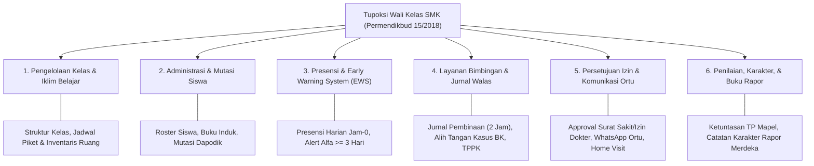

# 📘 Blueprint Arsitektur: Dashboard Wali Kelas SMK
**Merger Riset Yuridis (Permendikbud No. 15/2018 & Kurikulum Merdeka) + Baseline Arsitektur Dashboard Kaprog**

---

> [!NOTE] **Dasar Yuridis & Kebijakan Nasional**
> Tugas pokok Wali Kelas secara resmi diatur dalam **Permendikbud No. 15 Tahun 2018** (Pasal 6 & Lampiran I - Ekuivalensi 2 Jam Tatap Muka Beban Kerja Guru), diperkuat oleh **Kepmendikbudristek No. 262/M/2022 & No. 56/M/2022** (Kurikulum Merdeka & Rapor P5), **Permendikbud No. 111 Tahun 2014** (Bimbingan dan Konseling), dan **Permendikbudristek No. 46 Tahun 2023** (Pencegahan & Penanganan Kekerasan di Lingkungan Satuan Pendidikan / PPKSP).

---

## 🔬 I. Riset Yuridis: 6 Bidang Tupoksi Utama Wali Kelas



### Rincian Analisis Tugas Pokok:
1. **Pengelolaan Rombel & Iklim Kelas (*Classroom Management*):**
   - Mengelola kelas agar kondusif, nyaman, dan aman bagi perkembangan fisik & psikologis siswa.
   - Mengorganisir perangkat kelas (Ketua Murid, Sekretaris, Bendahara, seksi-seksi) dan jadwal piket kebersihan.
2. **Penyelenggaraan Administrasi Kelas (*Classroom Administration*):**
   - Menata buku daftar hadir peserta didik, buku jurnal kelas, buku inventaris ruang kelas, dan mencatat mutasi peserta didik (masuk, pindah, atau berhenti).
3. **Presensi & Early Warning System (EWS):**
   - Melakukan verifikasi kehadiran harian (jam ke-0/jam pertama).
   - Menjalankan deteksi dini terhadap siswa dengan risiko putus sekolah atau penurunan disiplin (indikator: akumulasi >= 3 hari alfa berturut-turut).
4. **Pembimbingan Karakter, Disiplin, & Kolaborasi BK (Permendikbud 111/2014):**
   - Bertindak sebagai pembimbing pertama (*first-line counselor*) sebelum alih tangan kasus (*referral*) ke Guru Bimbingan Konseling (BK).
   - Melakukan deteksi dini dan tindakan pencegahan terhadap perundungan (*bullying*), intoleransi, atau kekerasan di rombel binaan sesuai Permendikbudristek 46/2023 (PPKSP).
5. **Interaksi & Komunikasi Orang Tua (*Parent Engagement*):**
   - Verifikasi dan persetujuan permohonan izin/sakit (*approval workflow*).
   - Fasilitator penghubung sekolah dengan wali murid (panggilan resmi, konferensi kasus, dan *home visit*).
6. **Penilaian, Rapor, & Kemajuan Belajar (Kurikulum Merdeka):**
   - Koordinasi dengan guru mata pelajaran untuk rekap ketuntasan tujuan pembelajaran (TP).
   - Pengisian catatan deskripsi perkembangan karakter dan catatan wali kelas pada Buku Laporan Hasil Belajar (Rapor).

---

## 🏗️ II. Kondisi Eksisting & Gap Analysis

| Dimensi | Dashboard Lama (`staff/walas/`) | Target Rekonstruksi Baru (Setara Kaprog) |
|---|---|---|
| **Struktur Berkas** | 22 berkas monolitik tidak terstandar, bercampur mock data | Modularitas **Pilar 21B** (8 Tab terpisah di `roles/walikelas/tabs/`) |
| **Konteks Akademik** | Terkunci di tahun aktif saja, tidak bisa melihat masa lampau | **SSOT Akademik Global** (`useAcademicFilter`) + Riwayat Historis |
| **Live KBM Rombel** | Tidak ada visibilitas guru yang mengajar di kelas hari ini | Deteksi sesi aktif real-time & alert kelas kosong (butuh guru inval) |
| **Persetujuan Izin** | Mockup UI tanpa sinkronisasi mutasi presensi | Workflow approval riil terhubung ke presensi harian & WhatsApp ortu |
| **Siswa PKL (SMK)** | Tidak termonitor sama sekali | Visibilitas siswa kelas XI/XII yang sedang di industri DUDI |
| **Pelaporan Resmi** | Berkas print standar terpotong | **True WYSIWYG** cetak buku jurnal, rekap bulanan, & surat pemanggilan |

---

## 🔄 III. Merger Arsitektur: Baseline Kaprog ➡️ Wali Kelas

Prinsip dasar arsitektur: **Struktur layout dan desain sistem Kaprog Dashboard diturunkan secara simetris, dengan transisi fokus dari Macro Scope (`jurusan_id`) ke Micro Scope (`kelas_id`).**

| Parameter Arsitektur | Dashboard Kaprog (Macro Scope) | Dashboard Wali Kelas (Micro Scope) |
|---|---|---|
| **Konteks Scope Data** | `jurusan_id` (Program Keahlian) | `kelas_id` (Rombongan Belajar Binaan) |
| **Rentang Populasi** | Ratusan siswa lintas angkatan X, XI, XII | ~36 siswa dalam satu rombel kelas binaan |
| **SSOT Akademik** | `useAcademicFilter` (Tahun Pelajaran & Semester) | `useAcademicFilter` (Tahun Pelajaran & Semester) |
| **Kemitraan/Pengajar** | Puluhan Industri DUDI & Guru Produktif | Guru Mapel yang mengajar di kelas rombel binaan |
| **Alur Tindak Lanjut** | Kebijakan Jurusan, Asesor UKK, MoU PKL | Approval Izin Ortu, Jurnal Walas, Rujukan BK |
| **Dokumen Output** | Sertifikat UKK, RAB UKK, Rekap Jurusan | Buku Leger Nilai, Rekap Presensi Bulanan, Rapor |

---

## 📊 IV. Matriks Temporal Pemantauan (Apa yang Harus Termonitor)

### 🔴 1. Real-time (Hari Ini)

| Item Monitor | Indikator KPI | Ambang Batas Alert Tindakan |
|---|---|---|
| **Konfirmasi Presensi Jam Pertama** | Status ceklis hadir jam ke-0/ke-1 | **Belum diverifikasi s.d. pk 07.30 WIB** |
| **Ketidakhadiran Siswa Rombel** | % kehadiran & jumlah siswa absen | **Alfa $\ge 1$ siswa tanpa surat/kabar** |
| **KBM Sedang Berlangsung** | Sesi KBM aktif di jadwal kelas saat ini | **0 sesi saat jam pelajaran (guru kosong butuh inval)** |
| **Inbox Permohonan Izin Ortu** | Surat sakit/izin masuk butuh verifikasi | **Pending > 1 surat belum di-approve** |
| **Siswa PKL (Fase F SMK)** | Absensi siswa rombel di lokasi DUDI | **Alfa di tempat PKL $\ge 1$ hari** |

### 🟡 2. Mingguan

| Item Monitor | Indikator KPI | Target Kinerja |
|---|---|---|
| **Tren Kehadiran Rombel** | Grafik fluktuasi hari Senin–Jumat | Rata-rata kehadiran rombel $\ge 90\%$ |
| **Keterisian Jurnal Walas** | Log bimbingan kelas & jam walas | **Minimal 1 agenda bimbingan per minggu (beban 2 jam)** |
| **Kepatuhan Regu Piket** | Catatan kebersihan ruang kelas | Evaluasi Jumat sore sebelum pulang |
| **EWS Siswa Kritis** | Siswa mangkir beruntun | Akumulasi $\ge 3$ hari alfa $\rightarrow$ Pemanggilan Ortu |

### 🟢 3. Bulanan / Semester

| Item Monitor | Indikator KPI | Target Kinerja |
|---|---|---|
| **Progress Nilai Mapel** | % ketuntasan nilai formatif/sumatif dari guru mapel | 100% tuntas sebelum sidang pleno rapor |
| **Rekap Presensi Bulanan** | Matriks bulanan resmi (H, S, I, A, D, B) | Ditandatangani & dicetak akhir bulan |
| **Resolusi Kasus BK** | Rekap intervensi & home visit bersama Guru BK | Status rujukan berubah menjadi `TERATASI` |
| **Kesiapan Rapor Kurikulum Merdeka**| Keterisian catatan karakter deskriptif wali kelas | Siap dibagikan pada tanggal pembagian rapor |

---

## 🎯 V. Komponen Blueprint: 8 Tab Modular Wali Kelas (Pilar 21B)

```
┌────────────────────────────────────────────────────────────────────────┐
│  🏫 Kelas Binaan: XII RPL 1  |  Program Keahlian: Rekayasa Perangkat Lunak│
│  Wali Kelas: Budi Raharjo, S.Pd  |  Semester: Ganjil 2025/2026         │
│  [👥 36 Siswa]  [⚡ 97.2% Hadir Hari Ini]  [⚠️ 2 Siswa Butuh Perhatian]│
└────────────────────────────────────────────────────────────────────────┘
```

### 1. 📊 TAB 1: Beranda / Ringkasan Rombel (`WalasBerandaTab`)
- **Hero Command Banner:** Menampilkan nama rombel, tingkat, jurusan pengampu, ruang kelas, wali kelas, semester aktif, serta badge mode (`LIVE_OPERASIONAL` / `HISTORIS_ARSIP`).
- **KPI Radar Kesehatan Kelas (Health Card Metric):**
  - % Kehadiran rombel hari ini (Hadir, Sakit, Izin, Alfa, Terlambat).
  - Indeks Kedisiplinan (Pelanggaran aktif & Poin sanksi kelas).
  - Status Izin Pending (Permohonan surat sakit/izin butuh approval).
  - Sesi KBM Aktif saat ini di kelas (Mapel apa, guru siapa, status hadir/inval).
- **Early Warning Alert Strip:** Peringatan langsung jika ada siswa tidak hadir >= 3 hari berturut-turut tanpa keterangan.
- **Agenda Kelas Hari Ini:** Jadwal pembinaan walas, jadwal piket kelas, atau agenda kunjungan rumah (*home visit*).

---

### 2. 👥 TAB 2: Data & Roster Siswa (`WalasSiswaTab`)
- **Daftar Peserta Didik Rombel (~36 Siswa):**
  - Nomor Absen, NIS/NISN, Nama Lengkap, Foto, Jenis Kelamin.
  - Nama Orang Tua/Wali, Nomor WhatsApp aktif (dengan tombol *Quick WhatsApp direct chat*).
  - Status Kelengkapan Berkas & Catatan Khusus (misal: beasiswa KIP, kebutuhan khusus, riwayat kesehatan).
- **Struktur Organisasi Kelas:**
  - Ketua Murid (KM), Wakil KM, Sekretaris, Bendahara, dan Seksi Bidang.
- **Tabel Regu Piket Kebersihan:**
  - Pembagian jadwal piket Senin s.d. Jumat.
- **Khusus Siswa PKL (SMK Fase F):**
  - Widget status penempatan industri bagi siswa rombel yang sedang bertugas di DUDI.

---

### 3. 📅 TAB 3: Presensi & Kehadiran Kelas (`WalasPresensiTab`)
- **Live Attendance Status:** Kehadiran hari ini (real-time sinkronisasi dari absensi gerbang/fingerprint/guru jam pertama).
- **Matriks Presensi Bulanan:**
  - Kalender kehadiran bulanan per siswa (H, S, I, A, D, B) lengkap dengan total persentase.
- **EWS (Early Warning System) Siswa At-Risk:**
  - Kartu khusus siswa berisiko (misal: Alfa tinggi, Sakit beruntun).
  - Rekomendasi tindakan otomatis: "Perlu Telepon Ortu", "Koordinasi Guru BK", "Jadwalkan Home Visit".

---

### 4. 📖 TAB 4: Jurnal Pembinaan Wali Kelas (`WalasJurnalTab`)
- **Pencatatan Agenda Pembinaan (Tupoksi Permendikbud 15/2018):**
  - Kategori: Jam Pembinaan Walas, Penanganan Kasus Siswa, Rapat Orang Tua, Catatan Karakter, Bimbingan Belajar.
  - Form Input Cepat: Tanggal, Waktu, Judul Agenda, Isi Catatan, Tag Karakter, dan Siswa yang Terlibat.
- **Riwayat Log Bimbingan:** Timeline intervensi pembinaan yang tersimpan rapi dan dapat diekspor menjadi lampiran bukti fisik kinerja wali kelas (beban kerja 2 jam).

---

### 5. 📩 TAB 5: Persetujuan Izin Siswa (`WalasIzinTab`)
- **Inbox Permohonan Izin Masuk:**
  - Surat izin/sakit yang diajukan orang tua siswa melalui aplikasi mobile / portal.
  - Tipe Izin: Sakit (dengan bukti surat dokter), Izin Keluarga, Dispensasi Lomba.
- **Action Approval:**
  - Tombol Setujui / Tolak dengan catatan alasan.
  - Tombol "Konfirmasi WhatsApp ke Ortu" untuk verifikasi keaslian surat sakit secara instan.
- **Sinkronisasi Presensi Otomatis:** Ketika disetujui, status absensi siswa pada hari tersebut otomatis berubah menjadi `S` (Sakit) atau `I` (Izin).

---

### 6. 🛡️ TAB 6: Kedisiplinan & Kolaborasi BK (`WalasDisiplinTab`)
- **Log Pelanggaran Siswa Rombel:**
  - Catatan pelanggaran yang diinput Guru Piket, Guru Mapel, atau Satgas Tata Tertib.
  - Kategori bobot (Ringan, Sedang, Berat) beserta poin pelanggaran.
- **Status Penanganan Bersama Guru BK (Permendikbud 111/2014):**
  - Alih Tangan Kasus (*Referral* ke BK): Wali kelas dapat merujuk siswa bermasalah ke BK dengan 1 kali klik.
  - Pelacakan Status Kasus: `Dalam Pemantauan`, `Pemanggilan Ortu`, `Home Visit`, `Konseling Selesai`.

---

### 7. 🏆 TAB 7: Prestasi & Apresiasi Karakter (`WalasPrestasiTab`)
- **Portofolio Prestasi Peserta Didik:**
  - Catatan prestasi akademik (olimpiade, lomba kejuruan LKS) dan non-akademik (olahraga, seni, organisasi OSIS/Pramuka).
  - Tingkat kejuaraan (Sekolah, Kota/Kab, Provinsi, Nasional, Internasional).
- **Apresiasi Karakter (Student Star / Badge):**
  - Penghargaan siswa teladan kelas (Disiplin Terbaik, Peningkatan Kehadiran Terpesat, Siswa Bergotong Royong).

---

### 8. 📑 TAB 8: Cetak, Rekap, & Rapor (`WalasRekapTab`)
- **True WYSIWYG Print & Export (Sesuai Skill Universal Document):**
  - Cetak Rekap Kehadiran Bulanan Format Resmi (F-BK-01 / Standar Administrasi Sekolah).
  - Cetak Buku Jurnal Kegiatan Wali Kelas (Portofolio Beban Kerja Guru ekuivalen 2 Jam).
  - Cetak Surat Pemanggilan Orang Tua / Surat Peringatan Siswa (dengan Kop Surat resmi sekolah dan QR Code verifikasi).
- **Kesiapan Rapor Kurikulum Merdeka:**
  - Ringkasan keterisian nilai dari guru mata pelajaran.
  - Form input catatan khusus wali kelas (*Catatan Rapor*) untuk masing-masing siswa.

---

## ⚡ VI. Panel Quick Actions & Pintasan Modul

```
┌─────────────────────────────────────────────────────────┐
│                 QUICK ACTIONS WALI KELAS                │
├──────────────┬──────────────┬──────────────┬────────────┤
│  👥 Data     │  📅 Absensi  │  📖 Tulis    │  📩 Cek    │
│   Siswa      │   Harian     │   Jurnal     │   Izin Ortu│
├──────────────┼──────────────┼──────────────┼────────────┤
│  🛡️ Kasus &  │  📚 Jadwal   │  📑 Buku     │  🖨️ Cetak  │
│   Rujukan BK │   KBM Kelas  │   Leger/Rapor│   Rekap Bln│
└──────────────┴──────────────┴──────────────┴────────────┘
```

| Pintasan Aksi Cepat | Rute Tujuan di Platform | Modul Terkait |
|---|---|---|
| **Data Siswa Rombel** | `/academic/siswa?kelas=xxx` | Academic |
| **Monitoring Presensi** | `/attendance/monitoring?kelas=xxx` | Attendance |
| **Pengajuan Izin Siswa** | `/kesiswaan/izin-siswa?kelas=xxx` | Kesiswaan |
| **Catat Pelanggaran & BK** | `/kesiswaan/pelanggaran?kelas=xxx` | Kesiswaan |
| **Jadwal KBM Rombel** | `/kurikulum/jadwal-pelajaran?kelas=xxx` | Kurikulum |
| **Input Nilai & Leger** | `/rapor/input-nilai?kelas=xxx` | Rapor |
| **Rekap Absensi Bulanan** | `/attendance/rekap?kelas=xxx` | Attendance |
| **Laporan Bimbingan** | `/reports/walas?kelas=xxx` | Reporting |

---

## 🗄️ VII. Pemetaan Kontrak Backend, Konteks Akademik & Penelusuran Historis

> [!IMPORTANT] **Kepatuhan Konteks Akademik & Akses Kelas Binaan Masa Lampau (Historical Homeroom Inspection)**
> Wali kelas tidak hanya bertugas pada tahun pelajaran berjalan, melainkan memiliki rekam jejak pembinaan rombel di masa lampau (misal: membina X RPL 1 pada 2024/2025, lalu XI RPL 1 pada 2025/2026, dan XII RPL 1 pada 2026/2027).
> 
> Seluruh aliran data di dashboard ini **WAJIB membawa Konteks Akademik SSOT (`tahunPelajaranId` & `semesterId`)** dengan kemampuan:
> 1. **Penyelarasan Dinamis:** Selector kelas otomatis mendeteksi dan menampilkan daftar rombel yang pernah dibina oleh guru bersangkutan pada periode terpilih.
> 2. **Dual-Mode Operasional vs Arsip:**
>    - 🟢 **Mode Operasional (Tahun Berjalan):** Akses penuh untuk presensi harian real-time, approval surat izin, input jurnal, dan penanganan kasus aktif.
>    - 🟡 **Mode Arsip Historis (Masa Lampau):** Mode inspeksi baca aman (*Read-Only Archive*) yang mengunci mutasi data kadaluwarsa, namun memberikan akses 100% untuk rekap kehadiran periode tersebut, histori catatan pembinaan, verifikasi leger nilai, dan pencetakan ulang berkas resmi.

### 🌐 Daftar Endpoint RESTful Backend Spesifik:

```http
# 1. Ringkasan Dashboard Komprehensif (Scoped Kelas & Periode Akademik)
GET /api/dashboard/walas/summary?kelas_id=xxx&tahun_pelajaran_id=xxx&semester_id=xxx

# 2. Rekap Matriks Kehadiran Bulanan Rombel
GET /api/dashboard/walas/attendance-matrix?kelas_id=xxx&bulan=2026-10

# 3. Status Sesi KBM Rombel Hari Ini (Live KBM & Inval Guru)
GET /api/dashboard/walas/kbm-status-today?kelas_id=xxx

# 4. Daftar Permohonan Izin Siswa Masuk
GET /api/dashboard/walas/leave-requests?kelas_id=xxx&status=PENDING

# 5. Persetujuan / Penolakan Permohonan Izin
PATCH /api/dashboard/walas/leave-requests/:id/approval

# 6. Early Warning System (Siswa Berisiko Mangkir >= 3 Hari)
GET /api/dashboard/walas/student-ews?kelas_id=xxx

# 7. Riwayat Kelas Binaan Historis Guru (Masa Lampau)
GET /api/dashboard/walas/academic-history?guru_user_id=xxx

# 8. Manajemen Jurnal Pembinaan Wali Kelas
GET  /api/dashboard/walas/journals?kelas_id=xxx
POST /api/dashboard/walas/journals
```

### Spesifikasi Backend Aggregator Service:

```typescript
// absenta_backend/src/modules/dashboard/services/sub/dashboard-walas-stats.service.ts

export interface WalasDashboardOptions {
  targetKelasId?: string;
  tahunPelajaranId?: string;
  semesterId?: string;
}

export interface HistoricalClassItem {
  kelasId: string;
  namaKelas: string;
  tingkat: number;
  jurusanNama: string;
  tahunPelajaranNama: string;
  semesterNama: string;
  tahunPelajaranId: string;
  semesterId: string;
  isCurrentActive: boolean;
  totalSiswa: number;
}

export interface WalasDashboardData {
  academicContext: {
    selectedTahunPelajaranId: string;
    selectedSemesterId: string;
    tahunPelajaranNama: string;
    semesterNama: string;
    isHistoricalPeriod: boolean;
    modeLabel: 'LIVE_OPERASIONAL' | 'HISTORIS_ARSIP';
  };
  daftarKelasBinaan: HistoricalClassItem[];
  kelasInfo: {
    id: string;
    nama_kelas: string;
    tingkat: number;
    jurusan: { nama: string; singkatan: string };
    totalSiswa: number;
    totalLaki: number;
    totalPerempuan: number;
    ruang: string;
    waliKelas: { id: string; nama: string; nip?: string };
  };
  kehadiranStats: {
    isLiveToday: boolean;
    tanggalData?: string;
    hadir: number;
    sakit: number;
    izin: number;
    alfa: number;
    terlambat: number;
    persentase: number;
    daftarTidakHadirHariIni?: Array<{ siswaId: string; nama: string; status: string; alasan?: string }>;
    rekapBulananSemester?: Array<{ bulan: string; persentaseRataRata: number }>;
  };
  kbmAktifHariIni?: {
    adaSesiAktif: boolean;
    jadwalSaatIni?: { mapel: string; namaGuru: string; jamKe: string; statusGuru: string };
  };
  earlyWarningAlerts: Array<{
    siswaId: string;
    nama: string;
    alfaCount: number;
    kategoriRisk: string;
    rekomendasi: string;
    statusIntervensi: 'PENDING' | 'TERTANGANI' | 'ARSIP';
  }>;
  izinPendingCount: number;
  totalPelanggaranPeriodeIni: number;
  totalPrestasiPeriodeIni: number;
  totalJurnalWalasTercatat: number;
}
```

---

## 📋 VIII. Roadmap Eksekusi & Status Implementasi

| Fase | Target Milestone | Status | Fokus Pekerjaan |
|---|---|---|---|
| **Phase 1** | **Clean Slate & Routing Konsolidasi** | ✅ **SELESAI** | 22 berkas lama dihapus, container baru `WaliKelasDashboard.tsx`, TSC 0 Error |
| **Phase 2** | **Tab 1: Beranda & Tab 2: Data Roster Siswa** | ⏳ **SELANJUTNYA** | `WalasBerandaTab.tsx`, `WalasSiswaTab.tsx`, Quick Actions Grid, Widget PKL |
| **Phase 3** | **Tab 3: Presensi EWS & Tab 4: Jurnal Walas** | 🔜 Antrean | `WalasPresensiTab.tsx`, `WalasJurnalTab.tsx`, Form Jurnal Pembinaan 2 Jam |
| **Phase 4** | **Tab 5: Approval Izin & Tab 6: Disiplin BK** | 🔜 Antrean | `WalasIzinTab.tsx`, `WalasDisiplinTab.tsx`, Alih Tangan Kasus BK |
| **Phase 5** | **Tab 7: Prestasi & Tab 8: Cetak True WYSIWYG**| 🔜 Antrean | `WalasPrestasiTab.tsx`, `WalasRekapTab.tsx`, Leger Nilai & Rapor Merdeka |
| **Phase 6** | **Backend Aggregator & Dual-Mode Cache** | 🔜 Antrean | `dashboard-walas-stats.service.ts` + Cache 60s & Scoping Masa Lampau |
